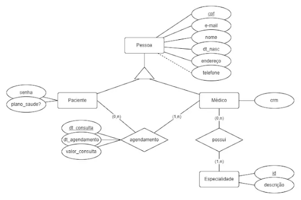

# Agendamento de consultas
Este exercício utiliza comandos DDL para construir tabelas do contexto "Agendamento de consultas", tendo como base o diagrama Entidade-Relacionamento (ER) e o dicionário de dados do cenário em questão, além do contexto escrito.

## Contexto do projeto
Confira abaixo o contexto do sistema agendamentos de consultas, que foi fornecido para a construção deste exercício.

### Objetivo
O sistema permite que um paciente possa realizar o agendamento de uma consulta, a partir de uma lista de médicos por especialidade. O paciente escolherá o horário disponível que lhe seja mais conveniente.

### Contextualização
As informações de pessoas são relativas aos pacientes e aos médicos. O paciente pode consultar os agendamentos utilizando uma senha de acesso, que é um conjunto de caracteres contendo entre 5 e 10 símbolos alfanuméricos.

Na solicitação de um agendamento, o funcionário da clínica fornece os dados do paciente (código, e-mail, senha, CPF, nome completo, endereço, telefone, data de nascimento e se o paciente possui plano de saúde), além disso, informa o CRM do médico e a data/hora da consulta. Adicionalmente, o sistema também armazena a data/hora do agendamento.

Ainda no procedimento de agendamento, o funcionário da clínica indicará o valor (R$) previsto para a consulta, que dependerá se o paciente possui ou não plano de saúde. Caso o paciente utilize qualquer plano de saúde, o valor previsto da consulta será R$ 0,00, caso contrário, a consulta custará um valor específico.

Os dados dos médicos (CRM, nome completo, especialidades, data de nascimento, CPF, endereço, telefone, e-mail) devem ser cadastrados previamente, assim como as suas respectivas especialidades (descrição e identificador). O identificador de uma especialidade é um código inteiro.

## Diagrama Entidade-Relacionamento (DER)
Confira o diagrama ER que orientou o desenvolvimento deste exercício.

